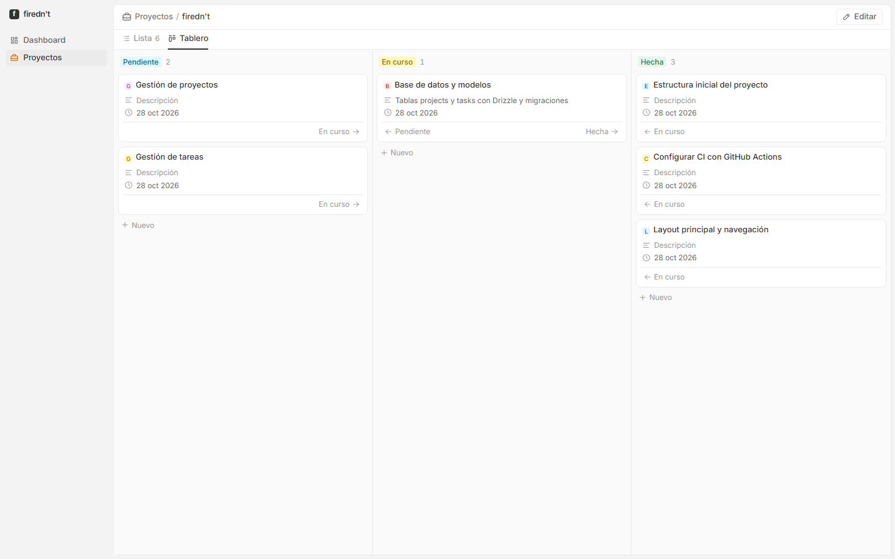

# firednt

[](https://github.com/XabierLDGA/Firednt/actions/workflows/ci.yml)

Plataforma web personal para gestionar proyectos de software desarrollados con IA.

- Visión y alcance del MVP: [docs/vision.md](docs/vision.md)
- Arquitectura y stack: [docs/architecture.md](docs/architecture.md)
- Decisiones técnicas: [docs/decisions/](docs/decisions/)



Más capturas en [docs/screenshots/](docs/screenshots/): dashboard, lista de proyectos, detalle, aprendizaje, modo oscuro y móvil.

## Requisitos

- Node.js 20.9 o superior (desarrollado con Node 24)
- npm

## Puesta en marcha

```bash
npm install
cp .env.example .env.local   # configuración local (base de datos)
npm run db:migrate           # crea la base de datos SQLite (firednt.db)
npm run db:seed              # opcional: carga datos de ejemplo
npm run dev
```

Abre <http://localhost:3000>.

> ⚠️ `db:seed` solo funciona con la base de datos vacía. Si ya tiene datos, no toca nada y avisa. `npm run db:seed -- --force` los **borra todos** y carga los de ejemplo.

## Comandos

| Comando | Qué hace |
|---|---|
| `npm run dev` | Servidor de desarrollo con recarga automática |
| `npm test` | Ejecuta los tests una vez |
| `npm run test:watch` | Ejecuta los tests y los repite al guardar |
| `npm run lint` | Revisa el código con ESLint |
| `npm run typecheck` | Comprueba los tipos de TypeScript |
| `npm run build` | Genera el build de producción |
| `npm start` | Sirve el build de producción |
| `npm run db:generate` | Crea una migración a partir de los cambios en `src/lib/db/schema.ts` |
| `npm run db:migrate` | Aplica las migraciones pendientes a la base de datos |
| `npm run db:seed` | Carga los datos de ejemplo (solo con la BD vacía; `-- --force` borra los existentes) |
| `npm run db:studio` | Abre un visor de la base de datos en el navegador |

## Variables de entorno

Copia `.env.example` a `.env.local`. Variables:

| Variable | Para qué | Valor por defecto |
|---|---|---|
| `DATABASE_URL` | Ubicación de la base de datos SQLite | `file:firednt.db` |
